# LMS Offline IPAS (bagian IPA) Kelas 4–6 · SDN Cipinang II

> **Tentang nama.** Di SD kelas 3–6, mata pelajarannya adalah **IPAS** (Ilmu Pengetahuan Alam dan Sosial). LMS ini memuat **bagian IPA** dari CP IPAS (Keputusan Kepala BSKAP No. 046/H/KR/2025). Topik IPS dari CP (peta, sejarah, budaya, ekonomi) belum disertakan.

LMS ini berjalan di **satu laptop sekolah sebagai server lokal**. Laptop lain, HP, dan smartboard membukanya lewat browser di Wi-Fi atau LAN sekolah. Semua fitur jalan **tanpa internet**, kecuali **Buat Soal dengan AI**.

> **Kenapa tidak di-hosting di Vercel atau Render?** Keduanya hosting cloud, jadi selalu butuh internet. Selain itu, paket gratisnya tidak menyimpan berkas unggahan dan database secara permanen. Akibatnya materi, video, dan bank soal bisa hilang sendiri. Sesuai rancangan, LMS ini dipasang di laptop sekolah. Cara ini gratis total dan datanya aman.

---

## 1. Isi folder

| Berkas/folder | Isi |
|---|---|
| `mulai-server.bat` | **Klik dua kali** untuk menjalankan LMS di Windows |
| `mulai-server.sh` | Versi untuk Linux/macOS |
| `server.js`, `src/`, `public/` | Kode program |
| `node_modules/` | Pustaka pendukung (sudah disertakan, tidak perlu internet) |
| `seed/` | Materi dan media contoh yang dimuat saat pertama kali dijalankan |
| `data/` | **Dibuat otomatis.** Berisi database (`lms.db`), media, dan backup. Folder inilah yang harus dijaga. |

---

## 2. Pemasangan pertama (Admin/operator, sekali saja)

### Cara termudah untuk sekolah lain: paket `LMS-IPAS.zip`

Satu berkas berisi LMS lengkap **beserta Node.js**, jadi laptop sekolah tidak perlu memasang apa pun dan tidak perlu internet.

1. Klik kanan `LMS-IPAS.zip` → **Extract All** → **Extract**.
2. Buka folder hasil ekstrak, masuk ke `LMS-IPAS`, lalu klik dua kali **`PASANG-LMS.bat`**. Jika muncul *Windows protected your PC*, klik **More info** → **Run anyway**.
3. Di jendela hitam, tekan **Enter** untuk memasang ke `C:\LMS-IPAS`. Klik **Yes** saat Windows meminta izin Administrator (untuk membuka firewall).
4. Tekan **Enter** sekali lagi untuk menjalankan LMS. Berikutnya cukup klik dua kali pintasan **LMS IPAS** di Desktop. Folder hasil ekstrak boleh dihapus.

Paket ZIP dipilih sebagai cara utama karena **Smart App Control** di Windows 11 memblokir program `.exe` yang belum bertanda tangan digital, tanpa tombol *Run anyway*. `PASANG-LMS.bat` memakai Node.js yang bertanda tangan resmi, jadi tetap bisa dijalankan.

**Installer berjendela `LMS-IPAS-Setup.exe`** juga tersedia dan hasilnya sama. Pakai bila laptop tujuan tidak memblokirnya: klik dua kali → biarkan `C:\LMS-IPAS` → **Pasang**.

**Memperbarui ke versi baru:** pasang paket versi baru ke folder yang sama. Data sekolah (akun, materi, soal, media) **tidak terhapus**. Tutup jendela hitam server lebih dulu.

**Menghapus (uninstall):** **Settings → Apps → Installed apps → LMS IPAS → Uninstall**, atau Start Menu → **Hapus LMS IPAS**. Di jendela penghapus, ketik **Y** untuk menghapus. Data sekolah **disimpan** kecuali Anda mengetik `HAPUS DATA`. Data yang disimpan otomatis dipakai lagi bila LMS dipasang ke folder yang sama.

**Buku Panduan Guru (PDF)** untuk sekolah: `public/panduan-guru.pdf`, bisa dibuka dari LMS (menu **Panduan Singkat**). Isinya cara pakai, pencegahan, tabel "kalau ada masalah", FAQ, dan kartu ringkas. Sumbernya `docs/panduan-guru/panduan.html`. Buat ulang setelah tampilan LMS berubah dengan `node tools/buat-panduan.js` (tangkapan layar baru + PDF) atau `--pdf-saja`. Untuk dikirim ke sekolah, buku ini dibagikan **terpisah** dari paket dalam format Word yang bisa diedit: `dist/Buku Panduan Guru LMS IPAS.docx`. **Admin lupa sandi:** jalankan `reset-sandi-admin.bat` di folder LMS.

**Membuat ulang paket** (di laptop pengembang yang memiliki Node.js 22.13+): jalankan `pwsh -File tools\buat-installer.ps1`. Hasilnya `dist\LMS-IPAS.zip` dan `dist\LMS-IPAS-Setup.exe`. Data di folder `data\` tidak ikut dikemas. Pemasangan tanpa pertanyaan untuk admin: `PASANG-LMS.bat --diam "D:\LMS-IPAS"`.

### Cara manual (dari folder proyek)

**Kebutuhan:** laptop Windows 10/11 dengan RAM ≥ 4 GB, router/access point (atau hotspot laptop), dan browser Chrome/Firefox terbaru.

1. **Pasang Node.js.** Unduh installer **versi LTS** dari nodejs.org saat ada internet, lalu pasang dengan pilihan bawaan (Next → Next → Install). Minimal versi 22.13. Simpan installer-nya di flashdisk untuk cadangan.
2. **Salin folder LMS** ke laptop server, misalnya ke `D:\LMS-IPA`. Jangan simpan di Desktop atau Downloads supaya tidak terhapus tidak sengaja.
3. **Klik dua kali `mulai-server.bat`.** Jendela hitam akan terbuka dan browser membuka `http://localhost:3000`.
   - **Sekali saja:** klik dua kali `izinkan-akses-jaringan.bat`, lalu klik **Yes**. Berkas ini membuka port 3000 di Windows Firewall untuk semua jenis jaringan. Tanpa ini HP dan laptop lain tidak bisa membuka LMS (muncul *This site can't be reached / took too long to respond*). Jendela server akan mengingatkan bila langkah ini belum dilakukan.
   - Jika Windows Firewall bertanya, centang **Private networks** dan **Public networks**, lalu klik **Allow access**.
   - **Jendela hitam jangan ditutup** selama LMS dipakai.
4. **Masuk** dengan akun bawaan, lalu **ganti kata sandinya** (diwajibkan saat pertama masuk):
   - Admin: `admin` / `admin123`
   - Guru: `guru` / `guru123`
5. **Beri alamat IP tetap** supaya alamat dan kode QR tidak berubah-ubah:
   - Cara paling mudah: di pengaturan router, cari menu *DHCP Reservation / Address Reservation*, lalu kunci IP laptop server (misalnya `192.168.1.10`).
   - Atau di Windows: *Settings → Network & Internet → Wi-Fi → (nama Wi-Fi) → IP assignment → Edit → Manual*. Isi IP `192.168.1.10`, Subnet `255.255.255.0`, Gateway = alamat router.
   - Jika tanpa router: nyalakan **Mobile hotspot** di laptop server. Alamatnya biasanya `192.168.137.1`.
6. **(Opsional) Kunci AI.** Masuk sebagai admin, buka **Admin → Pengaturan**, lalu tempel kunci API Gemini (lihat bagian 5).
7. **(Opsional) Konversi PPT.** Pasang **LibreOffice** (gratis) di laptop server supaya berkas .pptx otomatis diubah menjadi PDF dan bisa ditayangkan. Tanpa LibreOffice, guru tetap bisa mengunggah PDF (di PowerPoint: *File → Save As → PDF*).

**Menjalankan otomatis saat laptop dinyalakan (opsional):** tekan `Win + R`, ketik `shell:startup`, lalu buat *shortcut* ke `mulai-server.bat` di folder itu.

---

## 3. Panduan Guru

### 3.1 Membuka LMS
- **Di laptop server:** buka `http://localhost:3000`.
- **Di HP:** menu utama ada di **bilah bawah layar** (Beranda, Soal, Media, Panduan, Menu). Di daftar materi, tombol **Sajikan** dibuat lebar di atas agar mudah diketuk.
- **Di HP/laptop lain:** sambungkan ke Wi-Fi sekolah yang sama, lalu **pindai kode QR** di halaman masuk atau ketik alamat yang tertera (misalnya `http://192.168.1.10:3000`).
- **Matikan data seluler di HP.** Android sering pindah sendiri ke data seluler karena Wi-Fi sekolah tidak punya internet. Jika muncul pesan "Wi-Fi tidak ada internet, tetap tersambung?", pilih **Tetap tersambung / Ya**.

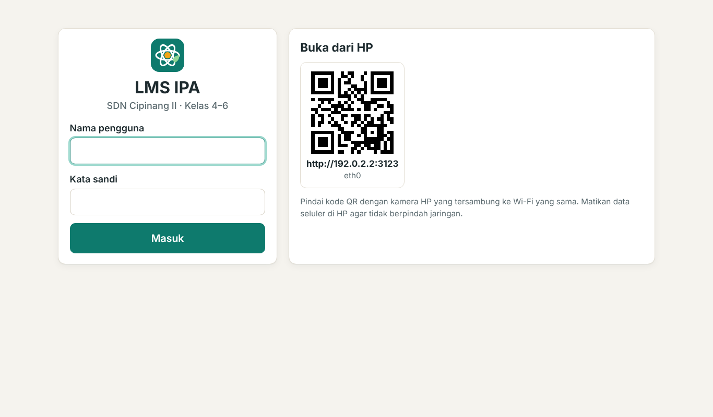

### 3.2 Beranda
Pilih **Kelas 4, 5, atau 6**. Tombol **Lanjutkan materi terakhir** membuka layar terakhir yang Anda tayangkan. Indikator di kanan atas menunjukkan apakah **Buat Soal AI** sedang bisa dipakai (online) atau tidak (offline).

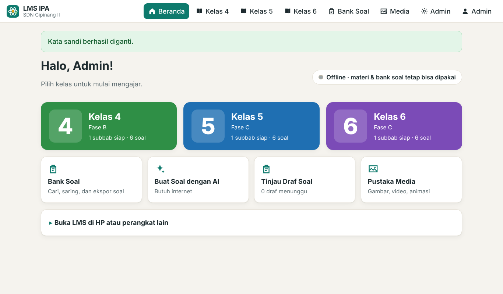

### 3.3 Menayangkan materi ke smartboard/proyektor
1. Di halaman kelas, klik **Sajikan** pada subbab.
2. Klik **Layar penuh** (atau tekan tombol `F`).
3. Setiap jenis layar punya ikon dan warna sendiri (🤔 Pemantik, 🎯 Tujuan, 🔍 Pengamatan, 💡 Penjelasan, 🏡 Contoh, 💬 Latihan, 📝 Rangkuman, 💭 Refleksi, 🏆 Penilaian), agar siswa tahu sedang di tahap mana. Pindah layar dengan tombol **Berikutnya/Sebelumnya**, tombol panah keyboard, *remote presenter*, atau **geser** di HP/smartboard.
4. Di layar **kegiatan dan diskusi**, klik **Petunjuk** untuk membuka bantuan satu per satu, lalu **Buka kunci** setelah siswa berdiskusi. Jawaban siswa tidak disimpan.
5. **Remote dari HP guru (opsional):**
   - Klik **📱 Remote HP** di kanan atas layar presentasi.
   - Pindai kode QR dengan HP yang tersambung ke Wi-Fi sekolah yang sama, lalu masuk dengan akun guru. Bisa juga dengan membuka `/remote` dan mengetik 4 angka kodenya.
   - Di HP tersedia tombol ◀ ▶ besar, daftar layar, tombol **Buka petunjuk** dan **Tampilkan kunci di layar**, serta **catatan guru**: kunci jawaban layar yang sedang tampil, yang hanya terlihat di HP.
   - Kode tetap berlaku saat pindah subbab, selama server tidak dimatikan.

### Cetak LKPD
Di halaman kelas, klik **LKPD** pada subbab (atau **Cetak LKPD** di halaman Edit subbab). Lembar kerja disusun otomatis dari kegiatan kelas:
- identitas siswa dan tujuan pembelajaran;
- prediksi, langkah kerja yang bisa dicentang, dan tabel pengamatan (dibentuk dari isian "Buat tabel: A | B | C");
- pertanyaan diskusi dengan baris jawaban, serta refleksi.

Pilih **versi siswa** atau **versi guru** (dengan kunci diskusi), lalu **Cetak** (langsung ke printer), **Unduh PDF**, atau **Unduh Word**.

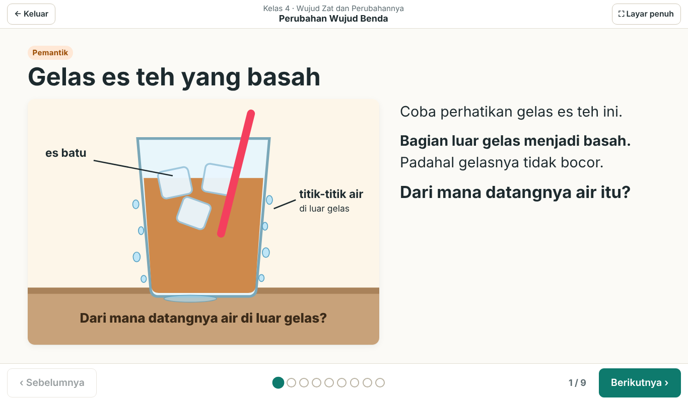
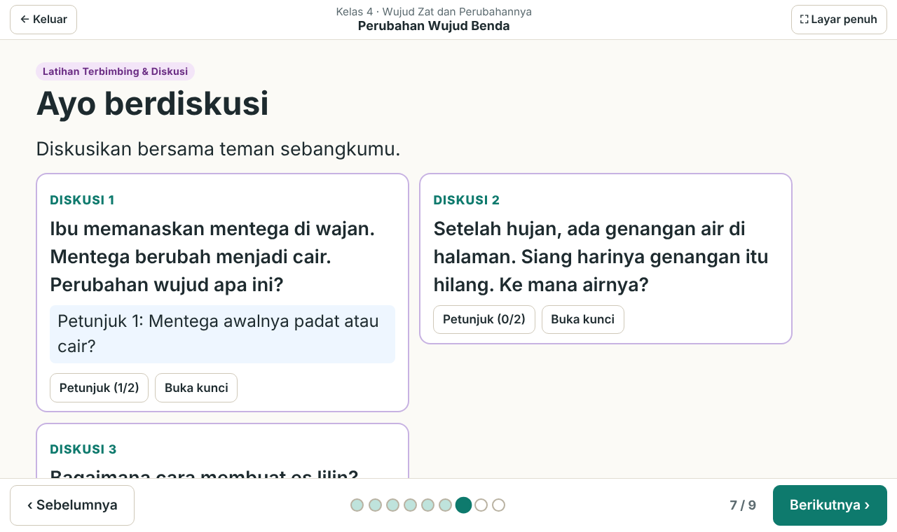
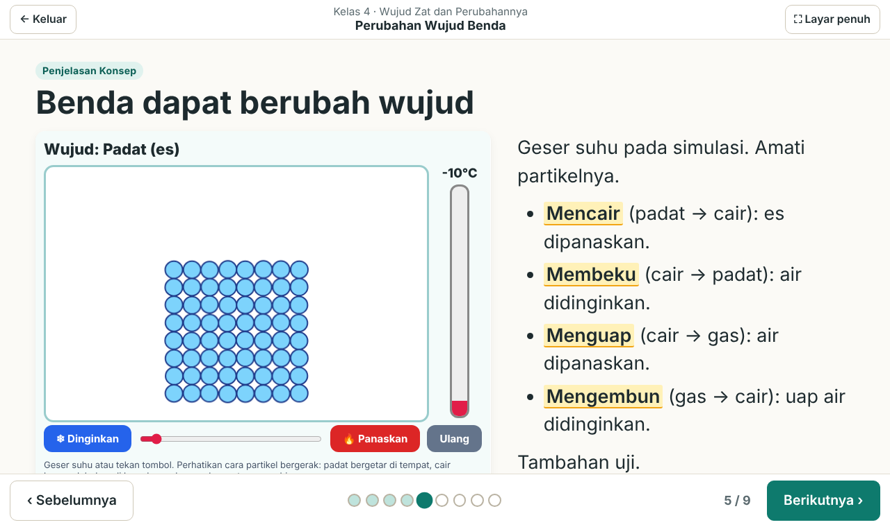

### 3.4 Menyusun materi
Setiap subbab otomatis memakai **templat 9 layar**. Urutannya mengikuti teori belajar dan alur Pembelajaran Mendalam (memahami → mengaplikasi → merefleksi):

| Urutan | Layar | Isi | Dasar |
|---|---|---|---|
| 1 | Pemantik | Foto/video fenomena nyata + 1 pertanyaan | Piaget, Gagné |
| 2 | Tujuan pembelajaran | 2–3 kalimat | Gagné |
| 3 | Kegiatan pengamatan | Prediksi, langkah, cara mencatat | Bruner (enaktif), inkuiri |
| 4 | Penjelasan konsep | Gambar/animasi/video + teks singkat | Bruner, Mayer, Sweller |
| 5 | Contoh di sekitar siswa | Contoh dari lingkungan setempat | Piaget, kontekstual |
| 6 | Latihan & diskusi | Pertanyaan bertahap + kunci tersembunyi | Vygotsky |
| 7 | Rangkuman | Maksimal 4 poin | Gagné |
| 8 | Refleksi | Apa yang sudah dipahami, apa yang masih membingungkan, dan cara menerapkannya (sudah ada pertanyaan bawaan) | Pembelajaran Mendalam; Wiggins & McTighe |
| 9 | Penilaian | Soal dari bank soal (otomatis) | Gagné |

**Kesesuaian kurikulum.** Bab dan tujuan pembelajaran bawaan mengikuti CP IPAS (bagian IPA) dalam Keputusan Kepala BSKAP No. 046/H/KR/2025: kelas 4 = Fase B, kelas 5–6 = Fase C. Tujuan memakai kata kerja CP (menganalisis, menyimpulkan, menghasilkan, merefleksikan). CP tidak membagi topik Fase B ke kelas 3 dan 4; pembagiannya ditentukan ATP sekolah. Di halaman **Kelas 4 → Atur bab & subbab**, setiap bab punya pilihan **Menurut ATP sekolah**: *Diajarkan di kelas 4* atau *Sudah di kelas 3 (pengulangan di kelas 4)*. Bab yang ditandai pengulangan diberi label "↺ Pengulangan dari kelas 3". Contoh ATP resmi tersedia di laman Inspirasi ATP Kemendikdasmen (guru.kemendikdasmen.go.id).

**Langkah:**
1. Halaman kelas → **Atur bab & subbab** → tambah bab atau subbab. Bab dan subbab bisa diurutkan ulang dengan ▲▼.
2. Klik **Edit** pada subbab. Isi tujuan pembelajaran, lalu ubah status menjadi **Terbit** jika sudah siap.
3. Klik **Edit** pada tiap layar. Tulis teks singkat, pilih atau unggah media, dan tambahkan kegiatan kelas.
4. Kotak **Pemeriksaan templat** memberi tahu jika masih ada layar kosong, belum ada media visual, atau satu layar terlalu padat.

**Aturan menulis (penting):**
- Satu konsep per layar. Jika penjelasan panjang, tambah layar *Penjelasan Konsep* kedua.
- Kalimat pendek, **maksimal 4 poin per layar**. Penghitung di bawah editor akan memberi peringatan.
- Tandai istilah baru dengan tombol **Istilah**, lalu beri arti sederhana.
- Mulai dari hal nyata (foto/kegiatan), lalu gambar/animasi, baru istilah dan definisi.
- Buang gambar hiasan yang tidak membantu konsep.

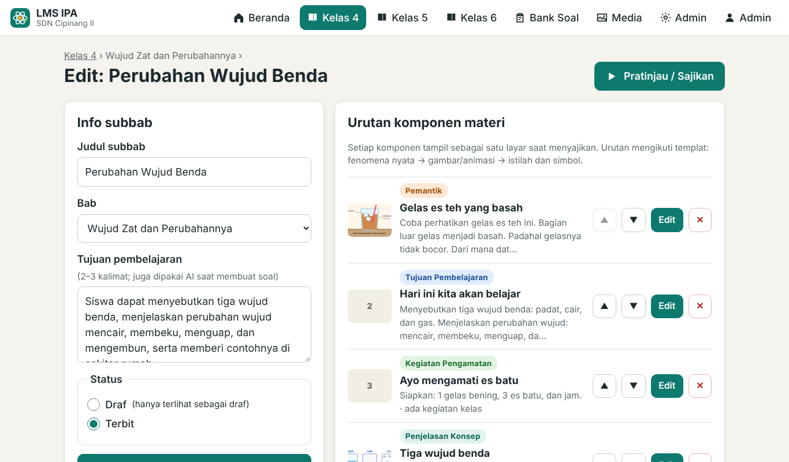
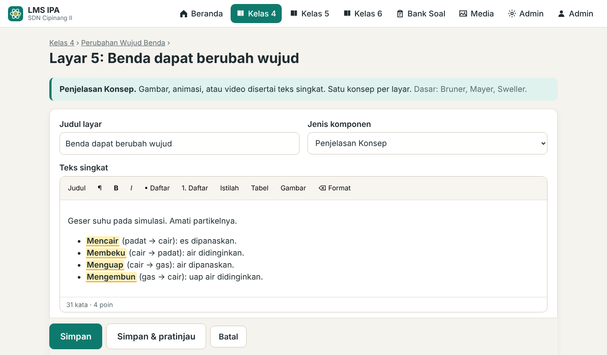

### 3.5 Media
**Media → Unggah media.** Format yang didukung:
- **Gambar:** JPG, PNG, SVG. Kompres supaya ringan di HP.
- **Video:** MP4 (H.264), **maksimal 720p**, durasi 2–5 menit, satu konsep per video. Sebelum mengunggah, LMS memeriksa video. Jika resolusinya di atas 720p, lebih dari ± 18 MB per menit, atau durasinya lebih dari 10 menit, muncul peringatan beserta saran mengompres (misalnya dengan HandBrake, preset "Fast 720p30"). Guru tetap boleh melanjutkan unggahan.
- **Animasi:** berkas HTML5 tunggal atau GIF.
- **Audio:** MP3.
- **Dokumen:** PDF (misalnya LKPD) dan PPT/PPTX.

Isi **Sumber** dan **Lisensi** untuk setiap media. Utamakan media buatan sendiri atau berlisensi terbuka. **Jangan menyematkan YouTube** karena butuh internet. Satu media bisa dipakai di banyak subbab.

> **Materi bawaan.** Ke-19 subbab sudah terisi lengkap: 9 layar, kegiatan kelas, media interaktif, dan 6 soal yang sudah disetujui, sesuai CP IPAS 046/2025. Guru tinggal **meninjau dan menyesuaikan** dengan kelasnya. Setiap layar **Pemantik** sudah diberi ilustrasi kartun beranimasi, dan pertanyaannya ditampilkan dalam balon kata bersama maskot **Si Ipa**. Ilustrasi ini sederhana buatan LMS. Bila ada, ganti dengan **foto atau video nyata** dari lingkungan siswa lewat **Edit layar**. Pertanyaan pemantik yang ditulis sebagai *Judul kecil* (H3) otomatis tampil di balon kata.

### 3.6 Membuat soal dengan AI
1. Pastikan laptop server **tersambung internet** (misalnya hotspot HP) dan indikator menunjukkan *Online*.
2. **Bank Soal → Buat dengan AI.** Pilih subbab, jenis soal, jumlah, dan tingkat kesulitan.
3. AI hanya memakai **teks materi subbab tersebut**, jadi lengkapi materinya dulu. Hasilnya masuk sebagai **Draf**.
4. **Tinjau setiap soal.** AI bisa salah, terutama kunci jawabannya. Edit atau hapus yang kurang tepat, lalu klik **Setujui**.
5. Hanya soal **Disetujui** yang muncul di layar Penilaian dan bisa dipakai tanpa internet.

Jika tidak ada internet, tombol nonaktif dan muncul penjelasannya. Guru tetap bisa **menulis soal manual**.

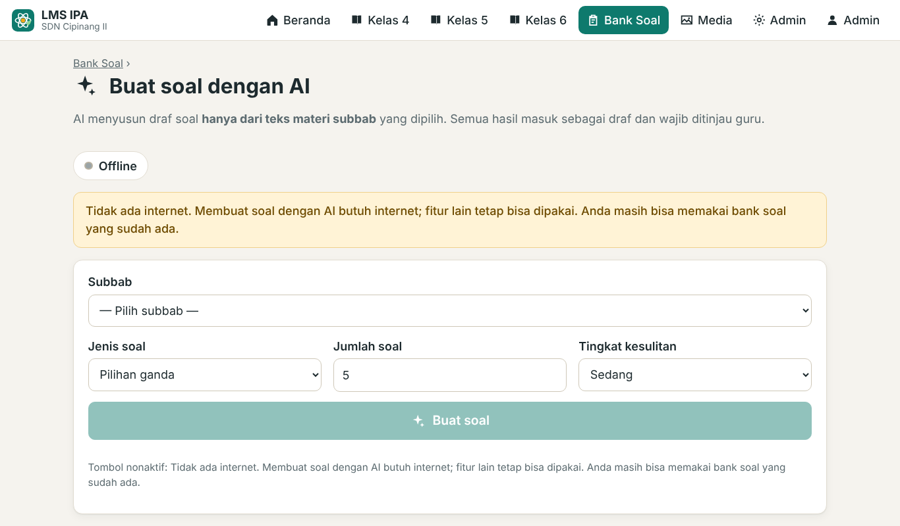
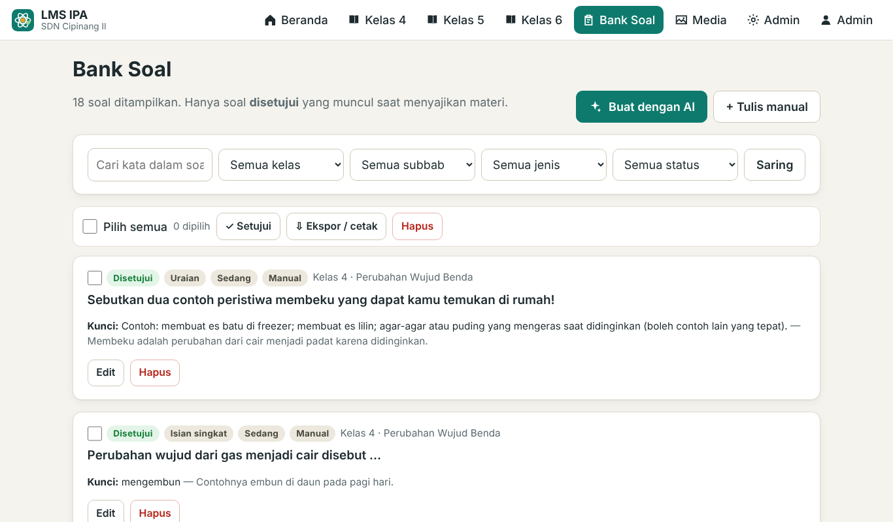

### 3.7 Mencetak soal
Di Bank Soal, centang soal yang dipilih, lalu klik **🖨 Cetak** atau **⇩ Unduh PDF**. Pilih dengan atau tanpa kunci jawaban, lalu:
- **Cetak:** membuka jendela cetak, lalu pilih printer.
- **Unduh PDF:** menyimpan berkas PDF untuk dibagikan atau dicetak nanti. Dibuat tanpa internet memakai Microsoft Edge/Chrome di laptop server.
- **Unduh dokumen Word (.doc):** bisa diedit lagi di Word.

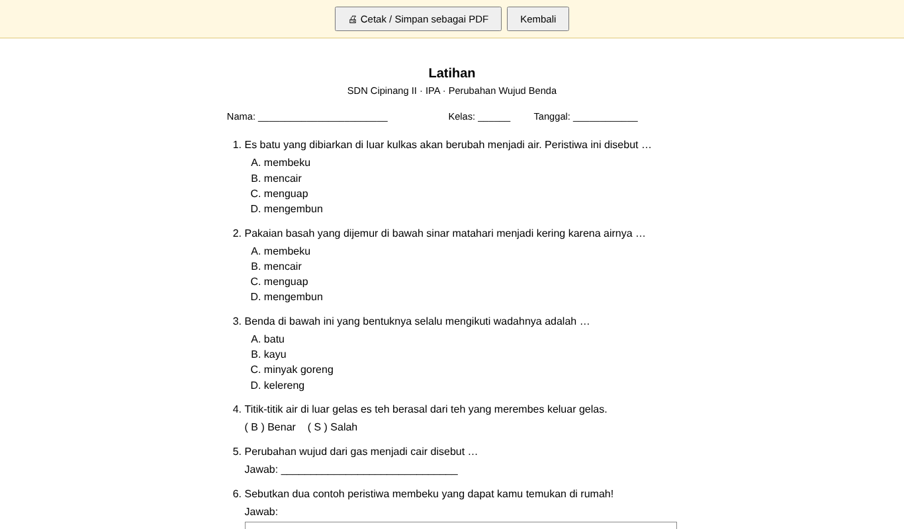

---

## 4. Panduan Admin

- **Pengguna** (Admin → Pengguna): buat akun guru, nonaktifkan, dan reset kata sandi. Untuk **ahli materi/media**, buat akun Guru sementara, lalu nonaktifkan setelah validasi selesai. Siswa tidak punya akun.
- **Backup** (Admin → Backup & Restore): klik **Buat & unduh backup**, atau ketik alamat flashdisk (misalnya `E:\`) lalu klik **Simpan ke folder**. Isinya database dan seluruh media dalam satu berkas `.zip`. **Lakukan minimal seminggu sekali.** Laptop juga menyimpan 10 backup terakhir di `data/backup`.
- **Restore:** unggah berkas `.zip` backup. Data saat ini otomatis dicadangkan dulu sebelum diganti.
- **Pengaturan:** kunci API Gemini, nama model, batas permintaan AI per hari, nama sekolah, lama sesi, dan pembatasan akses hanya dari jaringan sekolah.
- **Catatan:** riwayat permintaan AI dan catatan kesalahan sistem.
- **Pindah laptop server:** buat backup, pasang LMS di laptop baru (bagian 2), lalu restore. Cara lain: salin seluruh folder `data/` saat server mati.

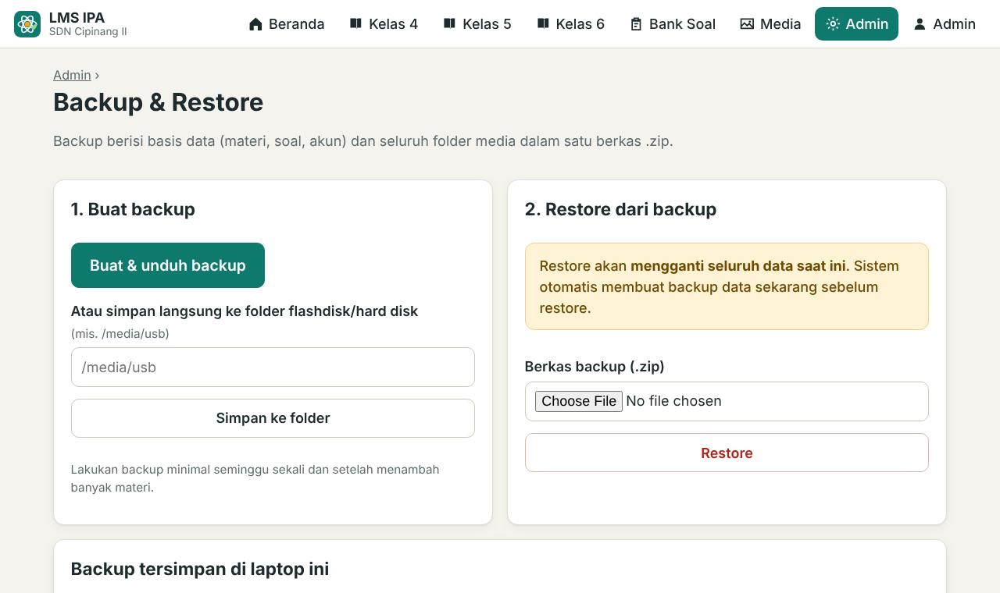

---

## 5. Kunci API Gemini (untuk Buat Soal AI)

1. Saat ada internet, buka **aistudio.google.com** dan masuk dengan akun Google sekolah.
2. Pilih **Get API key → Create API key**, lalu salin kuncinya.
3. Di LMS: **Admin → Pengaturan →** tempel di *Kunci API Gemini* → **Simpan**.
4. Klik **Tes kunci & tampilkan model yang tersedia**. Jika model yang dipilih tidak ada di daftar, isi *Nama model* dengan salah satu nama dari daftar (pilih yang mengandung `flash`).

Kunci hanya tersimpan di server dan tidak pernah dikirim ke browser atau HP. Paket gratis Google AI Studio punya batas pemakaian, jadi atur **Batas permintaan AI per hari** (bawaan: 20). Satu permintaan menghasilkan sampai 10 soal. Catat biayanya di anggaran proposal jika kelak memakai paket berbayar.

---

## 6. Masalah yang sering terjadi

| Masalah | Solusi |
|---|---|
| HP/laptop lain: *This site can't be reached* atau *took too long to respond* | 1) Jalankan `izinkan-akses-jaringan.bat` di laptop server (bagian 2 langkah 3). 2) Pastikan perangkat di Wi-Fi/hotspot yang sama, **data seluler dimatikan**, dan jendela server masih terbuka. 3) Pakai alamat yang tertulis di jendela server (alamat bisa berubah setiap tersambung ulang). 4) **Wi-Fi kampus/kantor** (mis. eduroam, Wi-Fi universitas) sering memblokir koneksi antarperangkat: pakai **router sekolah sendiri** atau **hotspot HP/laptop**. Internet tidak diperlukan. |
| Alamat/QR berubah setiap hari | Pasang IP tetap (bagian 2 langkah 5). |
| "Akses hanya diizinkan dari jaringan sekolah" | Perangkat memakai IP non-lokal. Matikan VPN atau data seluler. |
| PPT tidak tampil | Pasang LibreOffice di laptop server, lalu buka media tersebut dan klik **Konversi ulang ke PDF**. Atau unggah versi PDF. |
| Video tersendat di banyak HP | Pakai MP4 720p atau 480p dan router yang dekat dengan kelas. Sebaiknya laptop server terhubung ke router dengan kabel LAN. |
| PDF tidak tampil di HP | Beberapa HP tidak bisa menampilkan PDF di dalam halaman. Pakai tombol **Buka PDF**. |
| Lupa kata sandi admin | Minta admin lain mereset. Jika tidak ada admin lain, hubungi pengembang. |
| Port 3000 sudah dipakai program lain | Ubah `set PORT=3000` di `mulai-server.bat`, misalnya menjadi 8080. |

---

## 7. Pemetaan fitur rancangan

| No | Fitur | Letak di LMS |
|---|---|---|
| F1 | Akses jaringan lokal | Halaman masuk dan beranda: alamat + kode QR. Semua aset lokal, tanpa CDN. |
| F2 | Login dan peran | Guru/Admin, sandi di-hash (scrypt), sesi berakhir otomatis, wajib ganti sandi awal |
| F3 | Beranda guru | Pilihan kelas, lanjutkan materi terakhir, pintasan, indikator online/offline |
| F4 | Struktur materi | Kelas → Atur bab & subbab (urutkan ulang, draf/terbit, tujuan pembelajaran) |
| F5 | Penyaji materi | Tombol Sajikan: layar penuh, tombol, keyboard, geser |
| F6 | Pustaka media | Menu Media: gambar, video, audio, animasi HTML5/GIF, PDF, PPT; satu media dipakai di banyak subbab |
| F7 | Kegiatan di kelas | Prediksi, langkah pengamatan, pertanyaan bertahap, kunci tersembunyi |
| F8 | Generate soal AI | Bank Soal → Buat dengan AI (Gemini, keluaran JSON terstruktur) |
| F9 | Tinjau dan bank soal | Draf → Setujui; cari dan saring per kelas, subbab, jenis, status |
| F10 | Ekspor soal | Cetak/PDF dan Word (.doc), dengan atau tanpa kunci |
| F11 | Kelola konten | Editor teks, unggah media, konversi PPT, pratinjau, status draf/terbit |
| F12 | Backup dan restore | Admin → Backup & Restore (.zip berisi database + media) |
| F13 | Pengaturan sistem | Admin → Pengaturan (kunci API, batas harian, info versi) dan Admin → Catatan |

---

## 8. Catatan teknis (untuk pengembang)

- **Teknologi:** Node.js (Express) + SQLite bawaan Node (`node:sqlite`, tanpa server basis data dan tanpa kompilasi). Front-end HTML5/CSS/JS tanpa framework dan tanpa CDN. Dependensi: `express`, `multer`, `adm-zip`, `qrcode`. Semuanya JavaScript murni, jadi folder `node_modules` bisa langsung disalin ke Windows/Linux/macOS.
- **Menjalankan:** `node server.js` (port diatur lewat variabel `PORT`, bawaan 3000). Folder data bisa dipindah lewat variabel `LMS_DATA_DIR`. Untuk mulai tanpa materi contoh: `LMS_TANPA_CONTOH=1`.
- **Struktur:**
  - `src/db.js`: skema dan pengaturan.
  - `src/auth.js`: sesi dan akses lokal.
  - `src/ai.js`: layanan Gemini.
  - `src/seed.js` dan `src/materi-lengkap.js`: materi bawaan beserta pembaruan otomatis antarversi.
  - `src/routes/*`: umum, materi (termasuk LKPD), media, soal (termasuk kuis dan Google Form), remote, dan admin.
  - `public/js/presenter.js`: mode presentasi dan sisi layar dari remote.
  - `public/js/remote.js`: halaman remote di HP.
  - `public/js/kuis.js`: kuis interaktif.
  - `public/js/editor.js`: editor dan kegiatan kelas.
- **Remote HP:** sesi remote disimpan di memori server, berupa kode 4 angka yang kedaluwarsa setelah 8 jam tidak dipakai. Sinkronisasi memakai Server-Sent Events (`/api/remote/:kode/events`), tanpa internet dan tanpa pustaka tambahan.
- **Uji otomatis:** jalankan `npm test`. Uji server mencakup semua halaman, kelengkapan 19 subbab, LKPD, kuis, script Google Form, remote, ekspor, backup, dan unggah. Uji tampilan memakai `playwright-core` dengan Chrome/Edge yang sudah terpasang, dan mencakup semua media interaktif, remote HP ke layar, serta kuis. Setiap uji menjalankan server terpisah dengan data sementara, sehingga data `data/` tidak tersentuh. Jika browser tidak ditemukan, uji tampilan dilewati. Untuk uji server saja: `npm run test:server`.
- **Keamanan:** sandi di-hash dengan scrypt dan percobaan login dibatasi. Cookie sesi bersifat HttpOnly dan SameSite. Animasi HTML dan SVG yang diunggah dijalankan dalam *sandbox*. Isi editor dibersihkan dari skrip. Akses dibatasi ke IP jaringan lokal. Kunci API hanya ada di server.
- **Mulai ulang dari nol:** hentikan server, lalu hapus folder `data/`. Akun awal dan materi contoh akan dibuat lagi.
